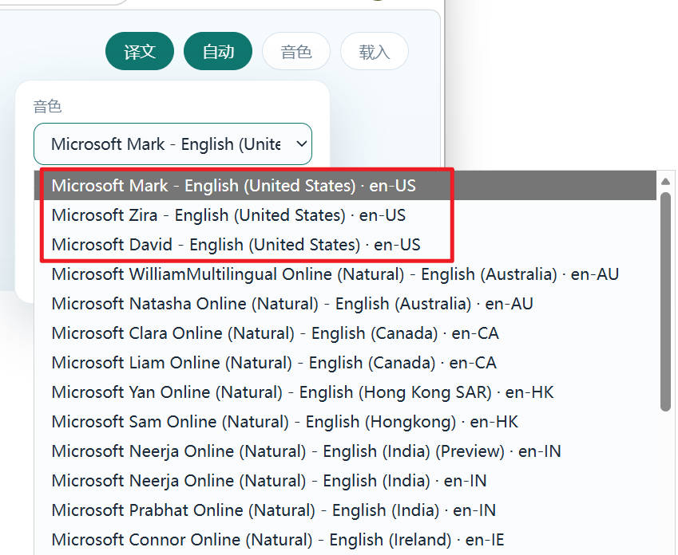
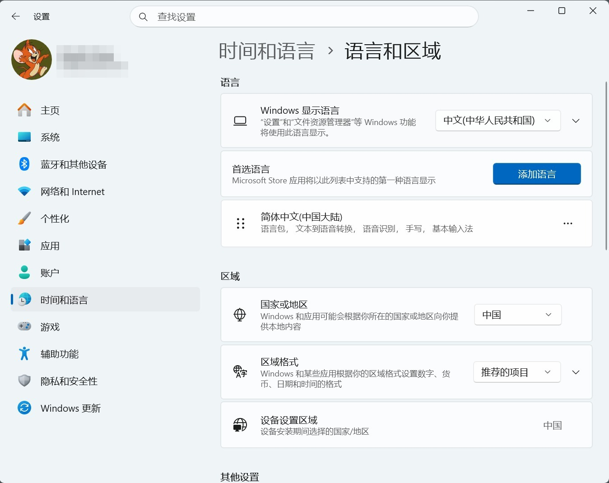
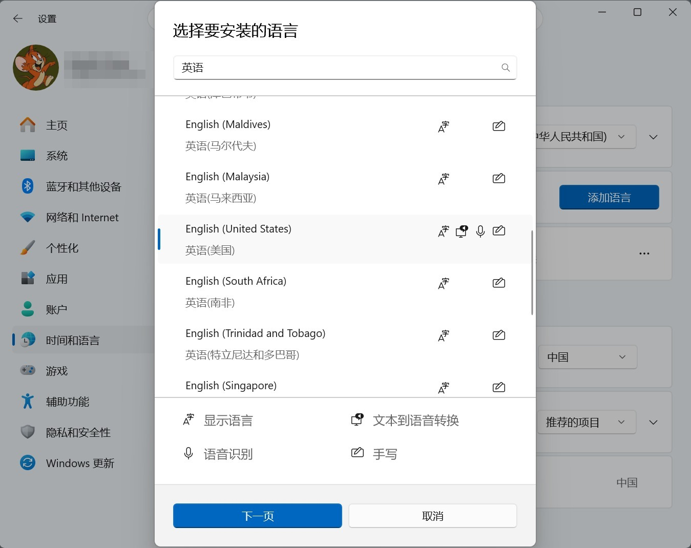
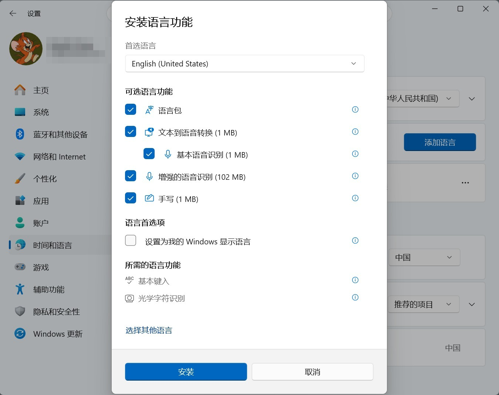
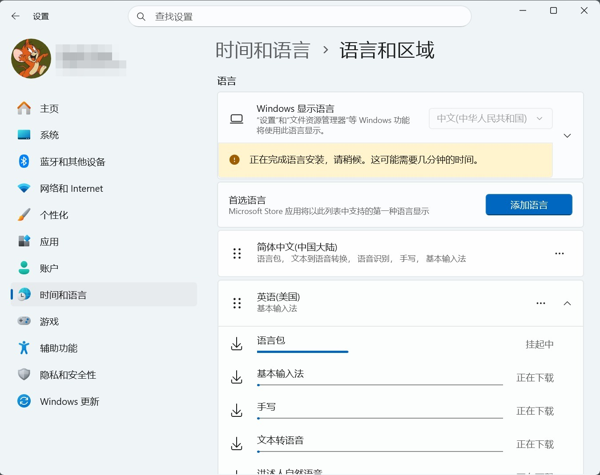

# 轻读 · 英语阅读器

把一个 JSON 变成可逐句朗读、逐词查义的英语阅读页。JSON 由你用 AI 生成，工具本身不解析、不改写文章。

启动：浏览器打开线上网页 http://u32-english-reader.u32.cn/ ；本地/离线部署时双击 `index.html` 同样可用，无需安装、无需联网。

<a href="assets/help/8.jpg" target="_blank" rel="noopener"></a>

## 特点

- **只用浏览器**：无后端、无构建、无依赖；线上网页直接用，本地部署双击 `index.html` 就能用
- **逐句朗读**：Web Speech 朗读整句，朗读时逐词高亮
- **听力遮挡**：顶栏「遮挡」用磨玻璃盖住英文，译文不受影响，状态自动记住
- **音色与语速可调**：顶栏「音色」里选系统英语语音、拖动语速（0.5×–2.0×），设置自动记住
- **点词即读**：点单词立即发音，同时出词卡，含上下文义项、词性、音标、重听按钮
- **没收录也不崩**：词表里没有的词仍可点击发音，只提示无释义
- **自带生成引导**：顶部「载入」面板里有可直接复制的 AI 提示词、字段说明和示例
- **常开日志**：浏览器控制台默认输出 `[LIGHT]` 日志，覆盖状态恢复、音色选择、快捷键与错误
- **三种载入方式**：选择文件、拖拽 `.json`、粘贴 JSON 文本

## 使用

1. 打开阅读器：线上网页 http://u32-english-reader.u32.cn/ ，或本地双击 `index.html`。
2. 点顶部「载入」，展开「没有 JSON？用 AI 生成」，复制提示词。
3. 把提示词和英文文章一起发给任意 AI，拿到 JSON。
4. 回到「载入」面板，粘贴 JSON 或点「加载 JSON 文件」，再点「载入」。

也可以直接把 `.json` 文件拖到页面上。

快捷键：`←` `→` 翻句，`↑` `↓` 调语速（每次 0.1×，带状态提示），`空格` 朗读本句（焦点不在单词、按钮或输入框时），`Esc` 关闭词卡/面板。

## 数据格式

见 [schema.md](schema.md)。最小结构：

```json
{
  "title": "文章标题",
  "sentences": [
    { "en": "English sentence.", "zh": "中文翻译。", "words": { "english": { "zh": "英文的", "pos": "adj.", "ipa": "/ˈɪŋɡlɪʃ/" } } }
  ]
}
```

`examples/demo.json` 是完整示例，`assets/demo.js` 是页面内置的同一份数据。

## 目录

```
index.html          页面
help.html           帮助中心（快速上手 / 功能 / 快捷键 / 离线语音 / FAQ / 数据格式）
assets/reader.css   样式
assets/app.js       交互逻辑
assets/demo.js      内置示例数据
assets/help/        帮助页面配图（统一 JPG）
examples/demo.json  示例数据（JSON 文件形式）
schema.md           数据格式规范 + AI 提示词
llms.txt            给 AI 的站点入口
```

## 浏览器要求

Chrome / Edge / Safari 较新版本。语音合成依赖系统语音包；如果没声音，检查系统是否安装了英语语音。

## 朗读很慢？换离线语音

音色列表里带 `Online / Online (Natural)` 的语音走在线合成，网络慢时首字延迟明显。选名字里**没有 Online** 的本地音色即可离线朗读：

- `Microsoft Mark - English (United States) · en-US`（男声，推荐）
- `Microsoft Zira - English (United States) · en-US`（女声）
- `Microsoft David - English (United States) · en-US`

完整步骤、避坑与断网验证见 [帮助页面](help.html)。

### 音色列表对照

<a href="assets/help/8.jpg" target="_blank" rel="noopener"></a>

红框内是本地音色；下面带 `Online (Natural)` 的是在线语音，别选。点击图片查看原图。

### 从零安装英语语音（装一次即可）

1. 打开 `设置 → 时间和语言 → 语言和区域`。

   <a href="assets/help/3.jpg" target="_blank" rel="noopener"></a>

2. 点「添加语言」→ 搜 `English` → 选 `English (United States)` → 下一步。

   <a href="assets/help/4.jpg" target="_blank" rel="noopener"></a>

3. 勾 **语言包** + **文本到语音**；语音识别、手写不需要可取消，别勾「设为显示语言」。

   <a href="assets/help/5.jpg" target="_blank" rel="noopener"></a>

4. 点「安装」，等进度走完；然后关闭并重新打开 Chrome / Edge，再打开页面「音色」列表。

   <a href="assets/help/6.jpg" target="_blank" rel="noopener"></a>

点击任意图片可在新标签页查看原图。

验证：选中 `Microsoft Mark` → 断网 → 刷新页面 → 按 `空格` 能朗读，说明离线生效。

## License

MIT
